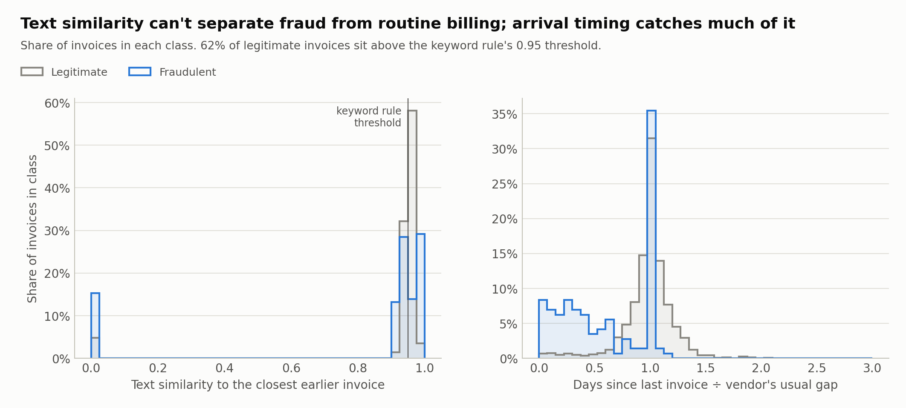
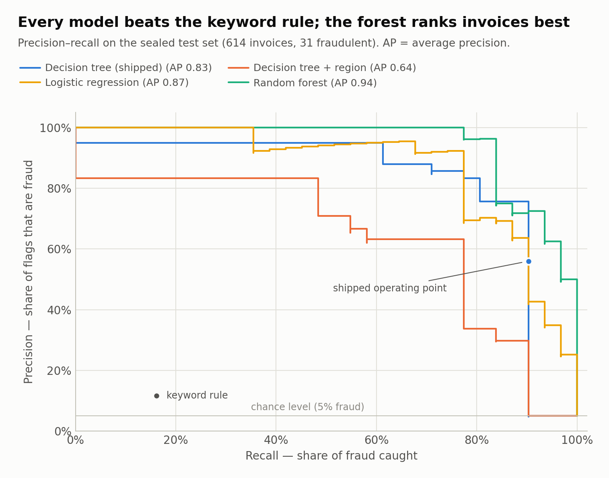
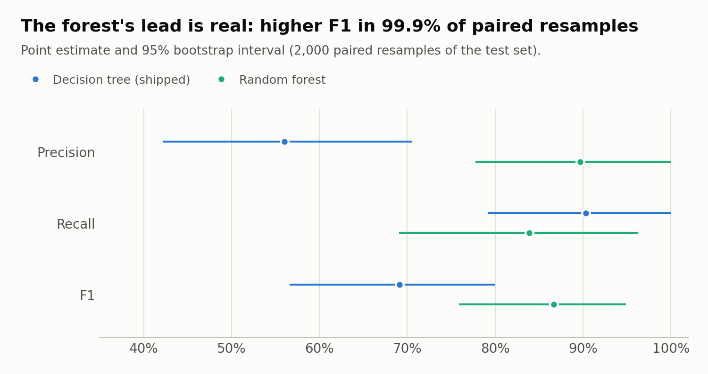
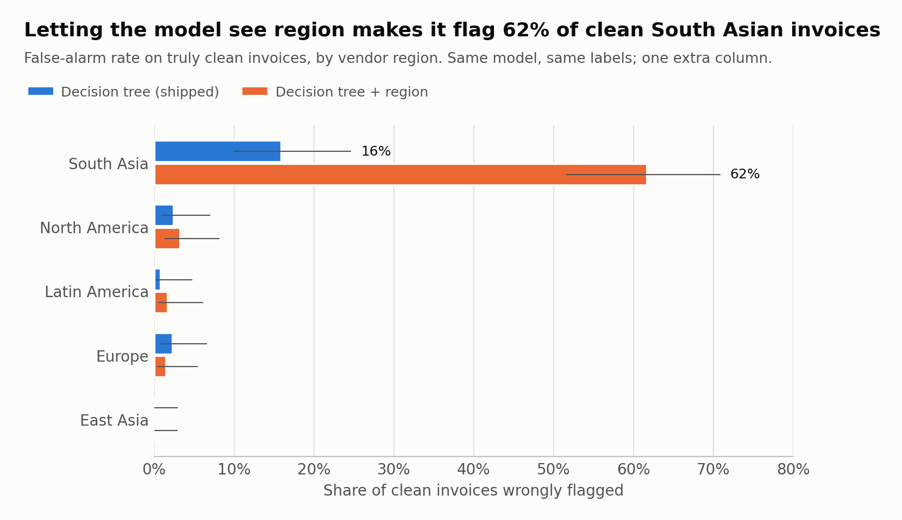
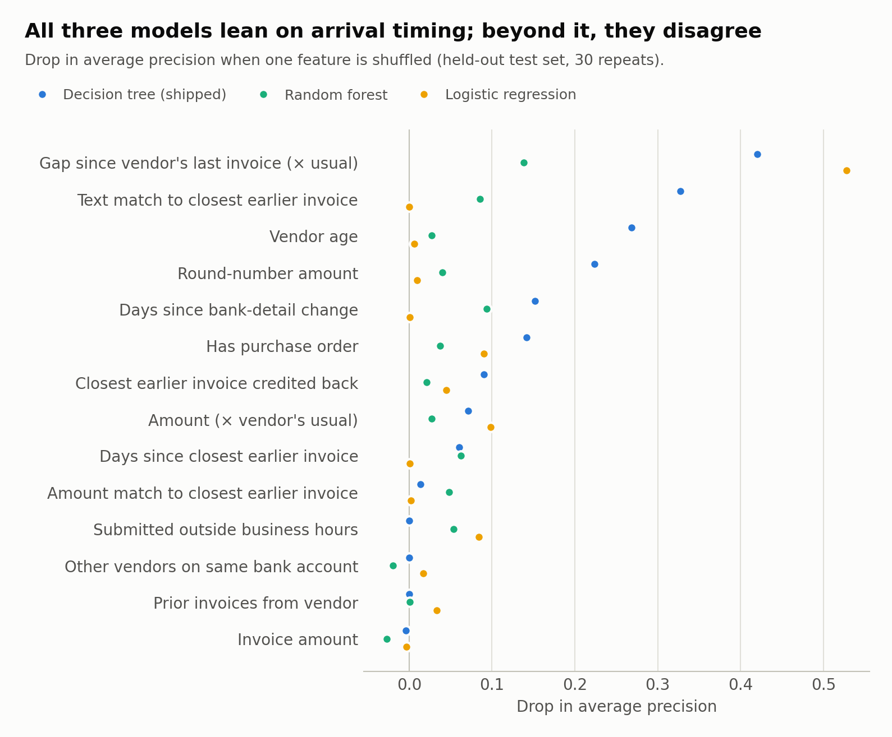

# Ledger Sentinel

**An AI agent that screens supplier invoices for fraud before they're paid, and a data science study of what it takes to make one accurate, explainable, and fair.**

> **In plain English.** Companies pay thousands of supplier invoices a month, and some are fraud: the same bill paid twice, a scammer pretending to be a real supplier, or a fake supplier. This project builds a program that reads each invoice before it is paid and decides to pay it, hold it, or block it. For every decision it shows the questions it asked and the records it used, so a person can check it. On the test data it caught about 9 in 10 fraudulent invoices while sending 12% of invoices to a person, and that slice held 93% of the fraudulent dollars ($1.05M of $1.13M). The data is simulated, so the numbers show the method works on patterns I planted, not how well it would do on a real company's invoices. The [stress tests](#stress-tests-how-far-do-the-numbers-move) below measure how much those numbers move when fraud is rarer, the planted patterns are weaker, or the fraudster adapts.

The agent reviews an accounts-payable payment queue, holds the invoices that shouldn't be paid, and writes an evidence-cited case note for the analyst. Around it is a full modelling workflow: leakage-free feature engineering, a time-based train/validation/test split, cost-weighted tuning, bootstrap confidence intervals, permutation importance, and a fairness audit under historically biased labels.

| Held-out test set: final 20% of the ledger by time (614 invoices, 31 fraudulent) | |
|---|---|
| Keyword rule (baseline) | catches **16%** of fraud at **12%** precision |
| Shipped model (depth-6 decision tree) | catches **90%** of fraud (95% CI 79–100%) at **56%** precision |
| Agent routing | sends **12%** of invoices to review; that slice holds **93%** of fraudulent dollars |
| Same model, also shown vendor region | flags **62%** of clean invoices from one region, vs **16%** without it |

*One ledger, one seed. Rebuilding the whole world from ten seeds, the shipped tree's recall averages 87% (range 71–97%) and its precision 49% (range 22–68%); see [Stress tests](#stress-tests-how-far-do-the-numbers-move).*

> **The data is synthetic** (see [Limitations](#limitations)). Every number measures whether the method recovers patterns planted in a simulated ledger. That shows the method works; it doesn't measure real-world accuracy.

The full analysis, with code, tables and figures, is in [`notebooks/analysis.ipynb`](notebooks/analysis.ipynb). The project website (in `docs/`, published with GitHub Pages) lets you open any invoice in the payment queue and see the decision, the model's exact rule chain, and the records behind it.

## Quick start

**See it.** Open `docs/index.html` in any browser (or the live site, once it's published). Click one of the three example invoices at the top of "Try the agent". The invoice panel shows what the agent decided, each question the model asked on the way, the records it relied on, and whether it got that invoice right. The menu at the top jumps to any other section (the results, the fairness audit, what drives the model's decisions, how it works) and marks the one you're reading.

**Run it.** Install the dependencies and run the whole pipeline: data, training, evaluation, website data, notebook and tests. It takes about six minutes (the stress tests are most of that).

```bash
pip install -r requirements-dev.txt
./run_all.sh
```

**Publish it.** Push the repo to GitHub, then go to **Settings → Pages → Deploy from a branch → `main`, `/docs`**. The site appears at `https://<username>.github.io/ledger-sentinel/`.

---

## The problem

An accounts-payable (AP) team processes thousands of supplier invoices a month. Three kinds of fraud get through, and all three are expensive:

- **Duplicate payment.** An already-paid invoice is resubmitted with a slightly different invoice number and a few dollars' difference. Exact-match deduplication misses it, and the company pays twice.
- **Vendor impersonation.** Someone posing as a known supplier emails AP with "updated" bank details. Days later a large invoice arrives, routed to the attacker's account.
- **Phantom vendors.** A fictitious supplier is added to the vendor list and bills for work never done.

The obvious fix is a rule: *flag anything nearly identical to an invoice we already paid.* It fails, because honest suppliers send near-identical invoices every billing cycle. **62% of legitimate invoices (1,797 of 2,917) are more than 95% text-identical to an earlier one.** Even tightened to also require a near-exact amount match, the rule catches 16% of the fraud at 12% precision.



The feature that works is timing. A duplicate isn't unusual because it resembles an old invoice. It's unusual because it arrives **too early for that vendor**. `gap_vs_vendor_cadence` compares the days since a vendor's last invoice with that vendor's usual gap. Honest invoices cluster around 1; duplicates arrive at a fraction of it.

---

## What the agent does

```
PERCEIVE   pull the invoices queued for the payment run
DECIDE     score each one, and recover the exact rule chain the model followed
ACT        route it: release, hold for review, or escalate and block payment
EXPLAIN    turn the decision path and the underlying records into a case note
```

The explanation step sends the model's decision path, plus the specific records involved (the earlier invoice it matched, the bank-detail change, the vendor's history), to Claude, which writes a short memo an analyst can act on. **Claude is never asked whether an invoice is fraudulent.** That's the model's job, and an LLM guessing at it would be the least reliable part of the system. Claude only narrates evidence that already exists.

---

## Results

Four models trained on identical features and identical labels, tuned on a validation slice, then scored once on the sealed test set:

| model | precision | recall | F1 | average precision |
|---|---|---|---|---|
| keyword rule (baseline) | 12% | 16% | 0.14 | — |
| **decision tree (shipped)** | **56%** | **90%** | **0.69** | **0.83** |
| logistic regression | 46% | 90% | 0.61 | 0.87 |
| random forest | 90% | 84% | 0.87 | 0.94 |
| decision tree **+ vendor region** | 30% | 90% | 0.45 | 0.64 |

By scheme, the shipped model catches 9 of 11 duplicate payments, 11 of 12 impersonations and 8 of 8 phantom vendors.



**The random forest is better, and we ship the tree anyway.** A paired bootstrap (2,000 resamples of the test set) puts the forest's F1 advantage at **+0.18 (95% CI +0.06 to +0.29)**, and the forest wins in 99.9% of resamples. So the gap is real, not noise from a small test set. We still ship the tree because the agent's job is to **hold a supplier's payment**, and that has to be justified to the supplier and to an auditor. The tree gives at most six readable conditions for every decision. The forest averages 300 trees and can't show its work. The trade-off is measured and stated, not hidden.



The tree's recall interval is wide (79–100%). That's what 31 fraud cases buy you, and it's the main reason a real deployment would need much more labelled history.

---

## Fairness under biased labels

Models train on **the labels a real team would have**: what past investigators wrote down, not ground truth. In this ledger one region spent years under a standing "enhanced scrutiny" policy, so **21% of its clean invoices carry a fraud label they never earned** (0% elsewhere).

Two decision trees, identical settings and identical labels. The only difference is that one was also allowed to see the vendor's region. False-alarm rates on **truly clean** invoices, with 95% Wilson intervals:

| region | shipped model | model that sees region |
|---|---|---|
| **South Asia** | **16.0%** (9.9–24.7) | **61.7%** (51.6–70.9) |
| North America | 2.5% | 3.3% |
| Europe | 2.3% | 1.6% |
| Latin America | 0.9% | 1.8% |
| East Asia | 0.0% | 0.0% |



1. **The region-aware model learned the historical bias and treated it as a pattern.** It flags three in five clean South Asian invoices, and its overall precision is lower. Bias didn't buy accuracy here; it reproduced the labels.
2. **Removing the column reduced the disparity but did not remove it.** Without region, clean South Asian invoices are still flagged at 16%, and the lower end of that interval (9.9%) sits above every other region's upper end (at most 7.0%). The biased labels are still in the training data, and the model reaches some of the same conclusions through behavioural features. **Dropping a sensitive column is a first step, not a fix.** The labels themselves would need to be re-adjudicated.

The mislabelling rate is a parameter we set, not a finding. The pattern holds at every level tested, from 10% to 28% of clean invoices mislabelled: the region-aware model flags 45–95% of clean South Asian invoices, against at most 7% elsewhere, and has lower F1 each time.

---

## What drives the decisions

Permutation importance on the held-out test set: shuffle one feature and measure how much average precision drops. It's the same measurement for every model, on data none of them trained on. Built-in importances aren't comparable across model types.



Arrival timing is the strongest signal for all three models, which backs up the feature-engineering argument above. Past that, the models disagree. The regression relies almost entirely on timing, while the tree also uses text similarity, vendor age and round amounts. Importance describes how a model used the data, not what causes fraud.

A second non-obvious feature is `closest_match_was_credited`. A legitimate rebill is preceded by a credit note against the original; a fraudulent duplicate is not, because the original was paid and stayed paid. This is the control AP departments actually rely on. About 1 in 6 credit notes never gets recorded, so it's a strong signal, not a perfect one.

---

## What the agent does to the payment queue

| decision | invoices | fraudulent | fraudulent dollars |
|---|---|---|---|
| escalate (score ≥ 0.75) | 37 | 28 | $1,047,484 |
| hold for review (0.35–0.75) | 37 | 0 | $0 |
| release (< 0.35) | 540 | 3 | $81,475 |

Analysts review **12% of the queue**, and that slice holds **93% of the fraudulent dollars**. The honest finding: the **hold** band caught no fraud on this test set, since every invoice in it was clean. The thresholds were set by policy, not fitted, so this is evidence the middle band should be re-tuned on validation cost the same way the model's own settings were.

The demo walks through three cases from the test set:

- **An impersonation caught.** $181,597, bank details changed five days earlier, four times the vendor's usual invoice.
- **A duplicate caught.** $25,280.48 against $25,200.00 three days earlier, never credited back.
- **An invoice that looks guilty but isn't, correctly released.** $17,516.24, 98% text-identical to an invoice for $17,385.45 from eight days earlier, no purchase order. The original was credited back, so this is a corrected rebill. Anyone can flag suspicious-looking invoices; the hard part is not flagging the honest ones.

---

## Stress tests: how far do the numbers move?

The results above come from one simulated ledger at a 5% fraud rate, with signals I planted myself. `src/robustness.py` asks what happens when that is less kind. It uses the same features, the same shipped-model settings and the same time-ordered split. The shipped model and the numbers above are not changed. Output: `out/robustness.json`.

**1. Ten rebuilt worlds.** Same method, ten different random seeds, each with its own sealed test period (22–34 fraud cases each).

| model | recall, mean (range) | precision, mean (range) |
|---|---|---|
| keyword rule | 18% (9–25%) | 11% (pooled over all ten) |
| decision tree (shipped settings) | 87% (71–97%) | 49% (22–68%) |
| random forest | 76% (58–84%) | 94% (90–100%) |

The shipped ledger's 90% recall sits toward the high end of that range, so quote the range, not the single number. The forest had higher precision in all ten worlds and equal or lower recall in all ten.

**2. Rarer fraud.** Real fraud is far rarer than 5%. Holding each model's recall and its false-alarm rate on clean invoices fixed (pooled over the ten worlds: 281 fraud and 6,221 clean invoices), here is precision at lower fraud rates:

| fraud rate | tree | forest | keyword rule |
|---|---|---|---|
| 5% (the simulated test sets average about 4%) | 50% | 94% | 13% |
| 1% | 16% | 76% | 3% |
| 0.5% | 9% | 61% | 1% |
| 0.1% | 2% | 24% | 0% |

At 1% fraud, about five of every six invoices the tree flags would be clean. The case for shipping the readable tree over the forest gets harder, not easier, at realistic rates. This is a calculation from measured rates, not a re-run; it assumes the model behaves the same on each invoice when fraud is rarer, and a model trained on rarer fraud would have fewer examples to learn from.

**3. Weaker planted signals.** Five seeds each. I weakened the two signals I most worried were doing the work: how many duplicate-payment fraudsters resubmit quickly (65% as shipped), and how many honest rebills have their credit note recorded (84% as shipped).

| setting | recall | precision | duplicate-payment recall |
|---|---|---|---|
| as shipped | 87% | 57% | 77% |
| quick resubmitters 35% | 86% | 54% | 78% |
| quick resubmitters 10% | 82% | 55% | 74% |
| credit notes recorded 50% | 84% | 51% | 70% |
| both weaker | 87% | 51% | 75% |

Results moved less than I expected. That means the model is not relying on those two dials alone. I did not test other ways the world could be harder, such as noisier labels or messier descriptions.

**4. A fraudster who waits.** The limitations list says a fraudster who knew the model watched billing rhythm would simply wait. Here I simulate it: duplicate-payment fraudsters resubmit after a full billing cycle for that vendor, with an amount that drifts like an honest recurring invoice. Everything else in the ledger is identical. Five seeds.

| | duplicate-payment recall | overall recall | overall precision |
|---|---|---|---|
| ordinary fraudsters | 77% | 87% | 57% |
| fraudsters who wait (model unchanged) | 56% | 76% | 54% |
| fraudsters who wait (model retrained on them) | 61% | 79% | 55% |

Waiting costs about 20 points of duplicate-payment recall, and retraining on the new behavior wins back only about 5. My reading, which I did not test, is that a duplicate timed and priced like an honest invoice leaves little for the model to separate beyond the credit-note control and the text match. Caveats: about 10 duplicates per seed, so single-seed numbers are noisy; and because waiting pushes duplicates later in the calendar, the attacked test window holds more of them (76 across five seeds vs 58).

**5. Re-tuning the "hold" band.** The shipped thresholds (hold from 0.35, escalate from 0.75) were set by policy, and on the shipped model the hold band caught no fraud. I tuned both thresholds on validation cost instead. The costs are my assumptions, not measurements: a missed fraud costs 6, a hold 1 and an escalation 2. The tuned thresholds (hold from 0.75, escalate from 0.95) did worse on the sealed test period: cost 99 against 88, and they released nine fraudulent invoices worth about $465k where the policy thresholds released one worth about $42k. The validation slice has only 24 fraud cases, which is too few to set two thresholds reliably. So the policy thresholds stay, and the loose end is closed with evidence rather than a rewrite. One more observation: with a model fit on the training period only, the hold band at the shipped thresholds does catch fraud (8 of 30 invoices). The empty hold band in the shipped model is a property of that one fit, not of the middle band.

**6. Do the case notes stick to the evidence?** `src/grounding.py` checks that every invoice number, vendor number, account suffix and figure in a note appears in the case it was written from, allowing for rounding. Six tests check the checker against notes written by hand from a real case: a faithful note passes, and an invented invoice number, amount, account or day count is caught. I have not run it on live notes from Claude. It checks that the facts are in the evidence, not that a note is well written or points the analyst to the best first check.

---

## Excluded features, and why

Listed in `src/features.py` as part of the deliverable, not as an omission:

| excluded | reason |
|---|---|
| `vendor_region` | Location is an attribute, not a behaviour. The fairness audit shows what including it costs. |
| vendor name shape | A proxy for national origin: the same problem, harder to see. |
| submitter identity | Flags the employee, not the transaction. |

Every feature that *is* used describes something the invoice or the vendor **did**.

---

## Method notes

- **Point-in-time features.** Every feature for an invoice is computed only from invoices and bank changes that came before it. Training and scoring call the same function, so the model can't see one set of numbers in the lab and another in production.
- **Split by time, not at random.** A random split lets a model learn from March to predict January. Fraud detection is forecasting, so train, validation and test are consecutive slices.
- **Three slices, not two.** Hyperparameters were tuned on validation; the test set was opened once, at the end.
- **Cost-weighted, not accuracy-weighted.** A missed fraud costs the invoice amount; a false alarm costs an analyst ten minutes. The model is given that ratio (6:1) explicitly.
- **Precision–recall, not ROC.** With a 5% fraud rate, ROC curves flatter every model.
- **Uncertainty on every headline number.** Paired bootstrap for model metrics; Wilson intervals for per-region rates, which stay sensible at small counts and near zero.

---

## Verified by tests

`python3 -m pytest` runs 29 checks, including:

- **No leakage.** An invoice's features are identical whether or not invoices and bank changes from its future are in the ledger. The test was confirmed to fail when a future-data leak is deliberately introduced.
- **Honest split.** Train, validation and test are ordered in time and share no invoices.
- **The sensitive column is really excluded** from the shipped model.
- **Headline numbers reproduce exactly** from a fixed seed.
- **The agent's three demo decisions are correct** against ground truth.
- **The LLM request contains the evidence and the instruction not to re-judge,** checked without a network call.
- **The website agrees with the evaluation.** Its numbers match `out/evaluation.json`, every invoice in the queue opens, every decision follows the thresholds, and every number the page's text refers to is defined.
- **The stress-test machinery is correct.** Default settings build the shipped ledger exactly; the adaptive-fraudster option changes only the duplicate-payment invoices; the rare-fraud precision formula reproduces the observed precision at the observed rate.
- **The grounding check catches invented facts** and accepts rounding (six tests, no network call).
- **The website tells visitors how to use it.** The top menu links every section in page order, the three-step guide is on the page, and each example invoice carries a description built from its own records.

---

## Limitations

- **Synthetic data.** Real AP ledgers are confidential and labelled fraud is rarer still. Results show the method works on planted patterns, not real-world accuracy.
- **Inflated fraud rate** (~5%, versus well under 1% in practice), so there are enough positives to learn from. Real class imbalance would be much harsher; the stress tests above put the tree's precision near 16% at a 1% fraud rate, as a calculation, not a re-run.
- **Small test set.** 31 fraud cases means wide intervals. Across ten rebuilt ledgers, the tree's recall ranged from 71% to 97%.
- **Three schemes, cleanly separated.** Real fraud blends, mutates, and adapts once it knows what's being detected.
- **Only one adversary was tested.** A fraudster who waits a full billing cycle cost the tree about 20 points of duplicate-payment recall, and retraining recovered about 5. Other evasions, and bank-swap or phantom-vendor fraudsters who adapt, were not tested. A real deployment would need drift monitoring.
- **Case notes are checked for facts, not quality.** The grounding check has not been run on live notes.

---

## Running it

Tested with Python 3.11 and 3.12. Package versions are pinned so the numbers above reproduce exactly.

**The website** is plain HTML, CSS and JavaScript in `docs/`, with no server and no build step. The trained models run once, offline, and `src/export_site.py` writes their results to `docs/data/site-data.js`. To preview it, open `docs/index.html` in a browser. It is published with GitHub Pages: **Settings → Pages → Deploy from a branch → `main`, `/docs`**.

**The full pipeline** (data, models, evaluation, website data, notebook, tests, command-line demo):

```bash
pip install -r requirements-dev.txt
./run_all.sh
```

About six minutes end to end. Claude's case notes are part of the command-line agent, not the website. To see them, set an API key first:

```bash
export ANTHROPIC_API_KEY=sk-ant-...
python3 src/demo.py
```

Individual steps:

```bash
python3 src/generate_data.py    # build the synthetic ledger
python3 src/train.py            # tune on validation, fit, save
python3 src/evaluate.py         # performance, fairness, interpretability report
python3 src/robustness.py       # stress tests -> out/robustness.json (about 3 minutes)
python3 src/export_site.py      # write the website's data
python3 src/demo.py --no-llm    # the agent, without network calls
python3 -m pytest -q            # the checks above
```

## Project structure

```
docs/                the website (GitHub Pages)
  index.html         page content
  app.js             payment-queue explorer, tables
  charts.js          dependency-free SVG charts
  style.css          light and dark themes
  data/site-data.js  generated by src/export_site.py
src/
  generate_data.py   synthesize the ledger and plant the fraud
  features.py        point-in-time feature engineering (+ the exclusion list)
  train.py           validation-tuned training: shipped model + baselines
  evaluate.py        performance, fairness, interpretability, scored separately
  analysis.py        bootstrap intervals, permutation importance, routing analysis
  robustness.py      ten seeds, rarer fraud, weaker signals, adaptive fraudster, hold band
  grounding.py       checks that a case note's facts are in its evidence
  figstyle.py        one colour-blind-checked visual system for every figure
  agent.py           perceive / decide / act / explain
  demo.py            three cases, live
  describe.py        the plain-English wording of each decision
  export_site.py     writes the website's data
notebooks/
  analysis.ipynb     the full analysis, executed, with figures
tests/
  test_pipeline.py   leakage, split, exclusion, reproducibility, agent checks
  test_robustness.py the stress-test machinery
  test_grounding.py  the grounding check
  test_site.py       the website's data and wording
out/
  figures/           charts used in this README
  decision_rules.txt the shipped tree's complete rule set
  robustness.json    every number in the stress-test section
```

---

## Related work, and what this adds

None of the pieces here are new. Commercial accounts-payable tools already do near-duplicate matching and vendor checks (for example [Hypatos](https://hypatos.ai/knowledge-base/ai-duplicate-payment-detection-invoice-fraud) and [Spendflo](https://www.spendflo.com/agents/ai-invoice-fraud-detection-agent)). Attacks that evade fraud models on tabular data are published research ([Cartella et al., 2021](https://arxiv.org/pdf/2101.08030)), as is the way a deployed model can skew the labels it later trains on ([Pombal et al., 2022](https://arxiv.org/pdf/2206.13183)). LLMs have also been applied to fraud detection in accounting records ([AuditCopilot](https://arxiv.org/pdf/2512.02726)). I read search summaries of these, not the full papers, so treat them as pointers. What this project adds is a small, fully reproducible package that puts those questions together on one ledger: a leakage-tested model, a fairness audit under biased labels, a simple adaptive adversary, and numbers reported with their uncertainty.

---

## Glossary

- **Held-out test set.** Invoices the model never saw while being built, used once at the end to see how it does on new cases.
- **Precision.** Of the invoices flagged, the share that really were fraud.
- **Recall.** Of all fraudulent invoices, the share that were caught.
- **Time-based split.** Training on earlier invoices and testing on later ones, like real use, instead of shuffling them together.
- **Leakage.** A model accidentally seeing information from the future, or the answer itself, during training. It looks great in testing and fails in real use. "Point-in-time" features are built to prevent it.
- **Bootstrap confidence interval.** A range showing how much a number would wobble if the test set had been a slightly different draw. Wide ranges mean few cases.
- **Cost-weighted.** Training the model to treat a missed fraud as worse than a false alarm, because it is.
- **Permutation importance.** Shuffle one input and see how much the model gets worse. A big drop means the model leaned on it.
- **Wilson interval.** A confidence interval for a rate that behaves sensibly when the counts are small or near zero.
- **Synthetic data.** Simulated data where I planted the fraud, so I know the right answers.

---

## Explaining it in three minutes

1. **The rule everyone writes first fails.** 62% of honest invoices look nearly identical to an earlier one, because that's what recurring billing is. The signal is timing: a duplicate arrives too early for that vendor.
2. **The agent catches the fraud and releases the honest lookalike.** An impersonation at $181,597, caught. Then the case that matters: a near-identical invoice eight days apart, $130 difference, correctly *released* because the original was credited back.
3. **Fairness.** Same model, one extra column: three in five clean invoices from one region get flagged, and accuracy drops. Removing the column helped but didn't fix it, because the bias lives in the labels.
